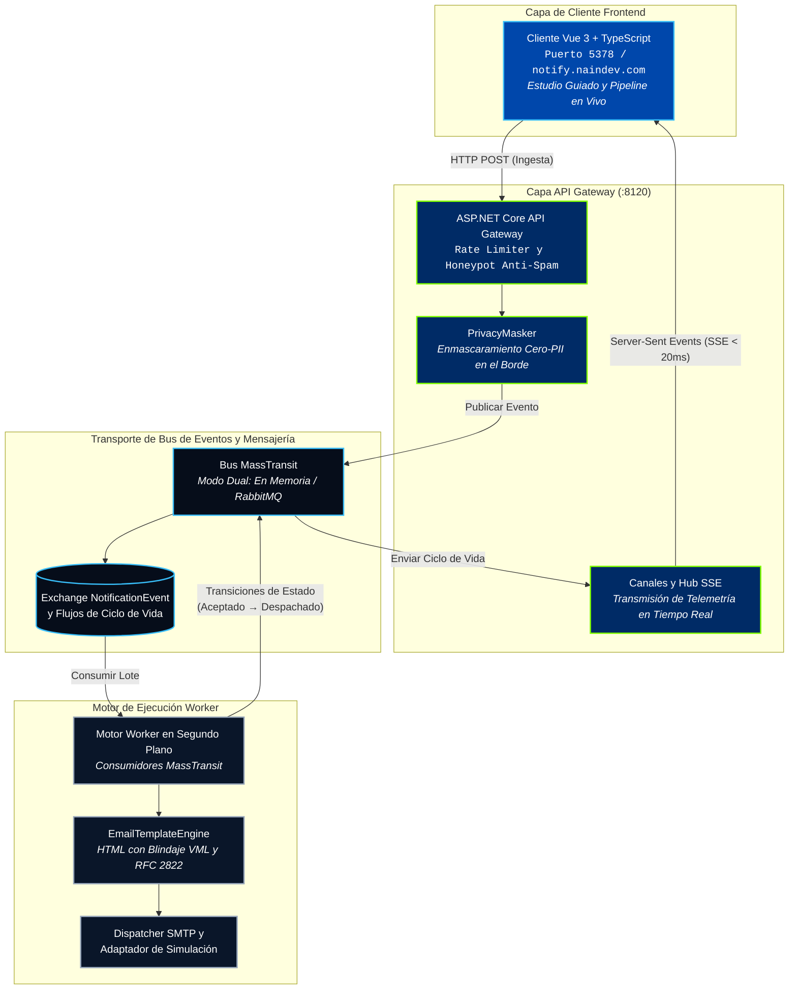

<picture>
  <source media="(prefers-color-scheme: dark)" srcset="docs/assets/banner-dark.svg">
  <source media="(prefers-color-scheme: light)" srcset="docs/assets/banner-light.svg">
  
</picture>

<div align="center">

[](README.md)
[](README.es.md)
[](https://notify.naindev.com/)
[](https://github.com/Nain9Dev/NainNotify/actions/workflows/codeql.yml)
[](https://dotnet.microsoft.com/)
[](tests/Notificaciones.UnitTests/Architecture/ArchitectureTests.cs)
[](https://codespaces.new/Nain9Dev/NainNotify)
[](https://vuejs.org/)
[](https://www.typescriptlang.org/)
[](tests)
[](LICENSE)

</div>

NainNotify es una pasarela de notificaciones dirigida por eventos y motor worker construido con .NET 10, Clean Architecture y MassTransit. Desacopla la ingestión HTTP de alto rendimiento del procesamiento en segundo plano, la renderización de correos electrónicos (HTML responsivo con compatibilidad VML para Outlook) y la ejecución de proveedores de entrega, mientras transmite los eventos de ciclo de vida del dominio directamente a un cliente de telemetría reactivo Vue 3 + TypeScript mediante Server-Sent Events (SSE).

---

## Visión General de la Arquitectura



---

## Gobernanza de Puertos

Todos los puertos de escucha están asignados de manera determinista de acuerdo con `dev-ports.json`:

| Servicio / Componente | Protocolo / Transporte | Puerto | URL / Ruta |
|:---|:---|:---|:---|
| **Cliente NainNotify (Vue 3)** | HTTP (Vite Dev / Preview) | `5378` | `http://localhost:5378` |
| **API Gateway** | HTTP (ASP.NET Core) | `8120` | `http://localhost:8120` |
| **Scalar Interactive API Docs** | HTTP (OpenAPI 3.0) | `8120` | `http://localhost:8120/docs` |
| **Swagger UI** | HTTP | `8120` | `http://localhost:8120/swagger` |
| **Flujo Telemetría SSE** | HTTP EventSource | `8120` | `http://localhost:8120/api/v1/Notifications/stream` |
| **Health Check y Diagnósticos** | HTTP | `8120` | `http://localhost:8120/api/v1/Notifications/health` |
| **Panel de Control RabbitMQ** | HTTP (Docker Compose) | `15672` | `http://localhost:15672` |

---

## Inicio Rápido en 60 Segundos

### 1. Ejecutar el API Gateway y Worker de .NET

Por defecto, el gateway se ejecuta en modo en-memoria sin dependencias externas:

```bash
dotnet run --project src/Notificaciones.Api
```

El gateway escucha en `http://localhost:8120`.

### 2. Ejecutar el Cliente Frontend de Demostración

En un terminal independiente:

```bash
cd Notificaciones.Client
npm install
npm run dev
```

Abre `http://localhost:5378` para iniciar el estudio interactivo guiado.

### 3. Ejecutar con RabbitMQ Distribuido (Docker)

Para ejecutar la topología multi-contenedor (API Gateway, Worker y RabbitMQ):

```bash
docker-compose up -d --build
```

---

## Matriz de Verificación y Pruebas

Ejecuta la suite de pruebas automatizadas a través de todas las capas arquitectónicas:

```bash
# Ejecutar pruebas unitarias y de integración (81 pruebas en total)
dotnet test MicroservicioNotificaciones.sln

# Verificación estricta de tipos TypeScript y compilación del frontend
cd Notificaciones.Client
npm run build
```

---

## Patrones de Diseño Clave y Garantías

1. **Cero Filtración de PII (`PrivacyMasker`)**: Todas las direcciones de destinatarios que entran a los flujos de telemetría públicos se enmascaran en el perímetro (ej. `a***r@naindev.com`).
2. **Defensa Honeypot Anti-Spam**: Los bots que completan campos ocultos reciben respuestas HTTP `202 Accepted` normales para evitar ser alertados, pero su carga útil se descarta antes de llegar a la cola.
3. **Server-Sent Events Desacoplados (SSE)**: El API Gateway mantiene canales de difusión delimitados con latidos de keepalive, transmitiendo cambios de estado con latencia inferior a 20ms.
4. **Plantillas Blindadas con VML**: La generación de correos utiliza Vector Markup Language para garantizar una visualización impecable en clientes Microsoft Outlook de escritorio y web.
