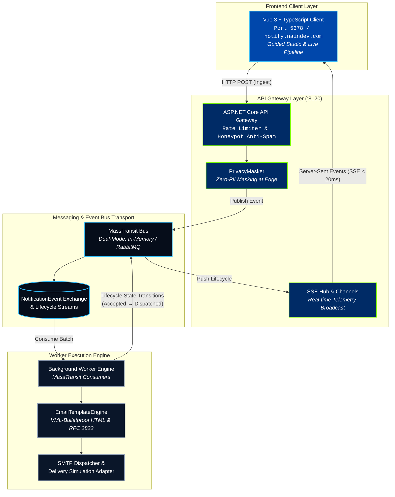

<picture>
  <source media="(prefers-color-scheme: dark)" srcset="docs/assets/banner-dark.svg">
  <source media="(prefers-color-scheme: light)" srcset="docs/assets/banner-light.svg">
  
</picture>

<div align="center">

[](https://notify.naindev.com/)
[](https://github.com/Nain9Dev/NainNotify/actions/workflows/codeql.yml)
[](https://dotnet.microsoft.com/)
[](tests/Notificaciones.UnitTests/Architecture/ArchitectureTests.cs)
[](https://codespaces.new/Nain9Dev/NainNotify)
[](https://vuejs.org/)
[](https://www.typescriptlang.org/)
[](tests)
[](LICENSE)

</div>

NainNotify is an event-driven notification gateway and worker engine built with .NET 10, Clean Architecture, and MassTransit. It decouples high-throughput HTTP ingestion from background processing, email rendering (responsive HTML with VML Outlook bulletproofing), and delivery provider execution, while streaming end-to-end domain lifecycle events directly to a reactive Vue 3 + TypeScript telemetry client via Server-Sent Events (SSE).

---

## Architecture Overview



---

## Port Governance

All listening ports are allocated deterministically in accordance with `dev-ports.json`:

| Service / Component | Protocol / Transport | Port | URL / Path |
|:---|:---|:---|:---|
| **NainNotify Client (Vue 3)** | HTTP (Vite Dev / Preview) | `5378` | `http://localhost:5378` |
| **API Gateway** | HTTP (ASP.NET Core) | `8120` | `http://localhost:8120` |
| **Scalar Interactive API Docs** | HTTP (OpenAPI 3.0) | `8120` | `http://localhost:8120/docs` |
| **Swagger UI** | HTTP | `8120` | `http://localhost:8120/swagger` |
| **SSE Telemetry Stream** | HTTP EventSource | `8120` | `http://localhost:8120/api/v1/Notifications/stream` |
| **Health Check & Diagnostics** | HTTP | `8120` | `http://localhost:8120/api/v1/Notifications/health` |
| **RabbitMQ Management** | HTTP (Docker Compose) | `15672` | `http://localhost:15672` |

---

## 60-Second Quick Start

### 1. Run the .NET API Gateway & Worker

By default, the gateway runs in zero-dependency in-memory mode, requiring no external databases or message brokers:

```bash
dotnet run --project src/Notificaciones.Api
```

The gateway listens on `http://localhost:8120`.

### 2. Run the Showcase Frontend Client

In a separate terminal:

```bash
cd Notificaciones.Client
npm install
npm run dev
```

Open `http://localhost:5378` to launch the guided studio: pick a scenario, send it, watch it travel through the pipeline and see the rendered email. With the gateway stopped the client runs on its standalone in-browser engine (same experience as the GitHub Pages deployment).

### 3. Run with Distributed RabbitMQ (Docker)

To run the distributed multi-container topology (API Gateway, Worker, and RabbitMQ):

```bash
docker-compose up -d --build
```

---

## Verification & Testing Matrix

Run the automated test suite across all architectural layers:

```bash
# Execute unit and integration tests (78 tests total)
dotnet test MicroservicioNotificaciones.sln

# Type-check and build the frontend client
cd Notificaciones.Client
npm run build
```

### Test Suite Composition

| Test Layer | Framework | Count | Scope |
|:---|:---|:---|:---|
| **Notificaciones.UnitTests** | xUnit | 55 | `PrivacyMasker`, `EmailTemplateEngine` (HTML escaping, VML bulletproofing), and `InMemoryNotificationTelemetryStore` arithmetic. |
| **Notificaciones.IntegrationTests** | xUnit + WebApplicationFactory | 23 | In-memory MassTransit bus, end-to-end 5-stage lifecycle transitions, sandbox recipient redirection, rate limiter policies, honeypot anti-spam, and SSE streaming. |
| **Notificaciones.Client** | vue-tsc + Vite | 1 | TypeScript strict template verification, contract alignment, production bundle generation. |

---

## Key Design Patterns & Guarantees

1. **Zero-PII Telemetry Leakage (`PrivacyMasker`)**: All recipient addresses entering public telemetry streams and event stores are masked at the edge (e.g., `e*******r@c*********p.com`).
2. **Honeypot Anti-Spam Gate**: Automated bots completing hidden input fields are met with standard `202 Accepted` responses to prevent detection, while their payloads are dropped before enqueuing.
3. **Decoupled Server-Sent Events (SSE)**: The API Gateway maintains bounded broadcast channels with keepalive heartbeats, broadcasting state changes without poll overhead.
4. **VML Bulletproof Email Layouts**: HTML email generation utilizes Vector Markup Language fallbacks, ensuring correct multi-column rendering across Microsoft Outlook desktop and web clients.

---

## Repository Structure

```
.
├── src/
│   ├── Notificaciones.Api/             # ASP.NET Core gateway, rate-limiting, SSE broadcast
│   ├── Notificaciones.Application/     # MassTransit consumers, email template rendering
│   ├── Notificaciones.Domain/          # Core events, NotificationLifecycleEvent contracts
│   ├── Notificaciones.Infrastructure/  # Smtp client, configuration loaders, serialization
│   └── Notificaciones.Worker/          # Standalone background worker entry point
├── Notificaciones.Client/              # Decoupled Vue 3 + TypeScript showcase client (port 5378)
├── tests/
│   ├── Notificaciones.UnitTests/       # 55 unit tests
│   └── Notificaciones.IntegrationTests/# 23 integration tests
├── docs/                               # Architecture decisions (ADRs), changelog, traceability
└── specs/                              # Spec-Driven Development specifications and task plans
```
