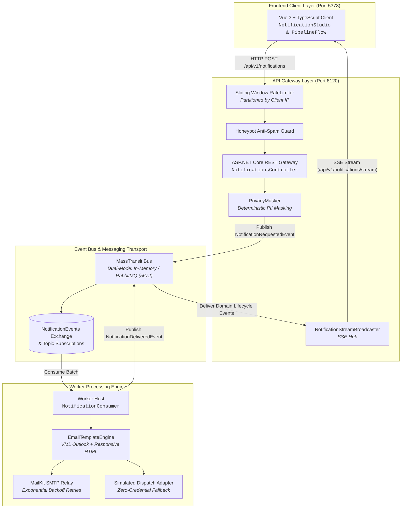

# Architecture Specification — NainNotify

## Architectural Style & Topology
NainNotify is structured following Clean Architecture principles combined with an Event-Driven Asynchronous Pipeline pattern. High-throughput ingestion is strictly separated from background rendering, third-party network dispatch, and real-time observability streaming.



---

## Project Structure & Layer Separation

```text
src/
├── Notificaciones.Domain/         # Pure domain entities, value objects, events, and enums.
│                                  # Zero dependencies on external packages, HTTP, or I/O.
├── Notificaciones.Application/    # Use case orchestrators, MassTransit consumer definitions,
│                                  # template contracts, and delivery interfaces.
├── Notificaciones.Infrastructure/ # Adapters: MailKit SMTP, PrivacyMasker, MassTransit RabbitMQ
│                                  # configuration, and template rendering engine.
├── Notificaciones.Worker/         # Standalone background execution host for scaled worker replicas.
├── Notificaciones.Api/            # ASP.NET Core Web API, rate limiters, honeypot filters,
│                                  # OpenAPI definitions, and Server-Sent Events broadcaster.
└── Notificaciones.Client/         # Standalone Vue 3 + TypeScript client (Vite, port 5378).
```

### Dependency Inversion Rules
1. **Domain Isolation**: `Notificaciones.Domain` has no dependencies on any other project in the solution, nor on external libraries.
2. **Application Decoupling**: `Notificaciones.Application` depends only on `Domain`. It defines outbound ports (`IEmailDeliveryService`, `ITemplateEngine`, `INotificationBroadcaster`) without knowing the concrete transport or provider implementations.
3. **Infrastructure Boundary**: `Notificaciones.Infrastructure` implements the ports declared in `Application`. Third-party dependencies (MailKit, MimeKit, RabbitMQ Client) are isolated within this layer.
4. **Presentation / Hosting**: `Notificaciones.Api` and `Notificaciones.Worker` act as composition roots and hosting environments.

---

## Architectural Fitness Tests
Architectural boundaries are deterministically verified in automated tests via `NetArchTest.Rules` inside `tests/Notificaciones.UnitTests/Architecture/ArchitectureTests.cs`:
- `Domain` must not reference `Application`, `Infrastructure`, `Api`, or `Worker`.
- `Application` must not reference `Infrastructure`, `Api`, or `Worker`.
- Controllers in `Api` must only interact through MassTransit endpoints and application interfaces.

---

## Port Allocation & Environment Configuration

| Service | Port | Protocol | Configuration Variable |
| :--- | :--- | :--- | :--- |
| **API Gateway** | `8120` | HTTP / SSE | `ASPNETCORE_URLS=http://+:8120` |
| **Vue Client** | `5378` | HTTP | `VITE_API_URL=http://localhost:8120` |
| **RabbitMQ AMQP** | `5672` | AMQP | `RabbitMq:Host=localhost`, `RabbitMq:Port=5672` |
| **RabbitMQ Mgmt** | `15672` | HTTP | Browser console (`guest`/`guest`) |
